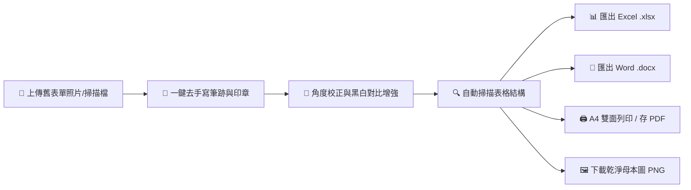

# 📋 ScanForm / Form Replicator (紙本表單掃描辨識・去手寫・一鍵還原)

> **紙本照片智慧掃描・一鍵抹除手寫與印章・自動偵測表格結構・直出 Excel (.xlsx) / Word (.docx) / 雙面 A4 PDF・100% 離線純前端零個資外洩**

[](https://cconecone-cmyk.github.io/form-replicator/)
[](LICENSE)
[](#-資安與隱私承諾)

---

## 🌟 什麼是 ScanForm？

無論是在**公家機關、各級學校、企業行號、診所或店面**，我們經常遇到以下痛點：
- 各類簽到表、報表、請假單、申請單、估價單、出勤卡、盤點清冊只有發黃、歪斜的舊紙本或影印件，甚至**已被填寫簽名或蓋上印章**。
- 想重新用 Excel 或 Word 繪製乾淨的空白母本，卻必須耗費數小時手動拉線、算欄寬與列高。
- 網路上的表單產生器往往要手動設定繁瑣欄位，不如直接給使用者 Excel 更自由快速！

**ScanForm** 是一款開源給所有教育者、行政人員與大眾的**純前端紙本表單掃描與還原神器**：
1. **🧹 智慧去手寫與印章**：一鍵抹除藍色、紅色原子筆墨水、紅色印章與鉛筆痕跡，並支援畫布塗抹橡皮擦，直接還原全新空白母本！
2. **🔍 表格網格智慧掃描**：自動分析紙本影像中的水平橫線與垂直縱線，將表單結構轉化為二維表格資料。
3. **📊 一鍵直出 Excel (.xlsx)**：由 SheetJS 在瀏覽器內極速打包產生標準 `.xlsx`，下載後在 Excel 自由編輯！
4. **📝 一鍵生成微軟 Word (.docx)**：純前端打包真實微軟 OpenXML 表格，下載即可在 Word 中排版。
5. **🖨️ A4 雙面向量列印 / 存為 PDF**：精確控制版面，一鍵列印正反兩面相同表單。
6. **🖼️ 高畫質純淨母本圖 (PNG)**：一鍵下載抹除筆跡後的白底黑字高清圖檔。
7. **🔒 100% 離線純前端運算**：免伺服器、免安裝、不回傳任何照片，機密公務表單安全零外洩。

---

## 🌐 線上免安裝版 (GitHub Pages)

👉 **立即使用**：[https://cconecone-cmyk.github.io/form-replicator/](https://cconecone-cmyk.github.io/form-replicator/)

> 支援所有現代瀏覽器（Chrome、Edge、Safari、Firefox、iPad/平板、手機），打開網址即可秒開秒用！

---

## 🚀 核心工作流程



---

## 💡 功能特色導覽

| 功能模組 | 說明 |
| :--- | :--- |
| **🧹 智慧去手寫筆跡** | 透過色彩通道分析，一鍵消除藍筆、紅筆、印章與鉛筆雜痕。 |
| **🖱️ 畫布擦除筆刷** | 支援滑鼠/觸控塗抹橡皮擦，自由抹除黑色簽名、塗改液殘留或隱私文字。 |
| **📐 傾斜角度補正** | 提供 ±15° 旋轉微調滑桿，拍照歪斜一秒拉正。 |
| **⚡ 黑白高對比化** | 濾除紙張陰影與底色雜點，強化格線對比。 |
| **🔍 格線投影辨識** | 橫向與縱向暗色像素直方圖分析，自動切分儲存格。 |
| **📊 Excel (.xlsx) 匯出** | 瀏覽器本機產生，自動設定最適欄寬，直接在 Excel 接力編輯。 |
| **📝 Word (.docx) 匯出** | 生成規範微軟 Word 表格，支援 A4 雙面分頁。 |
| **🖨️ A4 雙面列印 / PDF** | 完美對應標準 A4 尺寸，印表機雙面列印直接裝訂。 |

---

## 💻 本地執行

本專案為**零建置步驟（Zero-Build）之純靜態網頁**：
1. 下載或 Clone 本專案：
   ```bash
   git clone https://github.com/cconecone-cmyk/form-replicator.git
   ```
2. 直接雙擊開啟 `index.html` 即可使用！

---

## 📄 開源授權

本專案採 [MIT License](LICENSE) 開源授權，歡迎所有人自由使用、修改、分發與商業整合。
